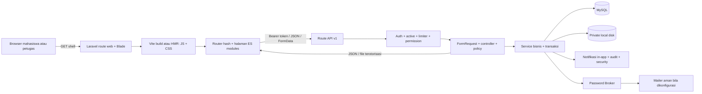
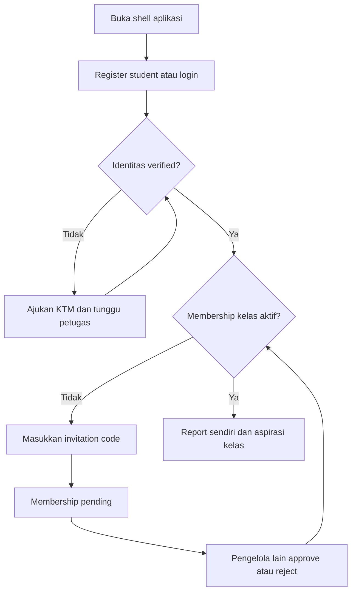
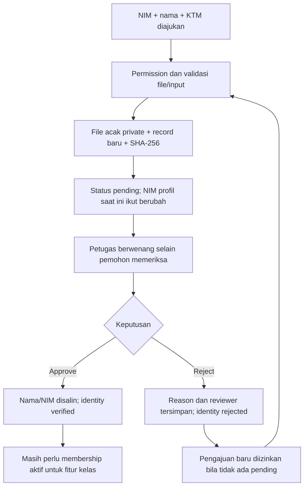
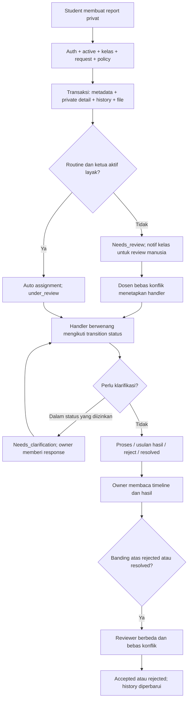
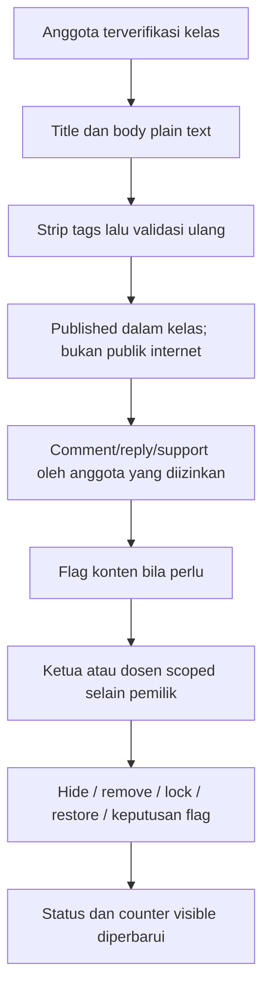
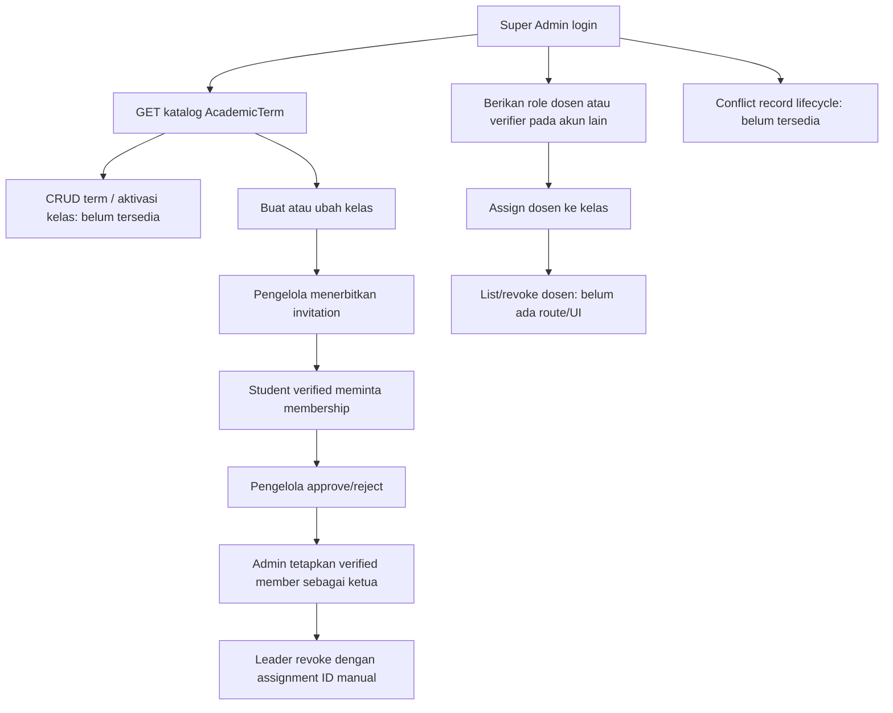
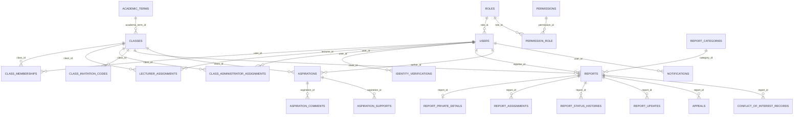

# Briefing Kerja Kelompok Ruang Dengar

**Tujuan dokumen:** bahan pengenalan, diskusi, pengujian, dan pembagian tugas berdasarkan `Promt12.md`. Dibuat dari pemeriksaan source, lockfile, migration, frontend, test, dan laporan audit yang tersedia. Dokumen ini tidak menjalankan ulang aplikasi, mengakses database, membaca KTM, atau mengubah data.

**Cara membaca bukti:** **Fakta source** menunjukkan implementasi yang ditemukan, bukan jaminan runtime berhasil. **Test tersedia** berarti kasus otomatis ditemukan dan dibaca. **Hasil historis** berarti eksekusi dilaporkan pada audit sebelumnya, bukan dijalankan saat penyusunan briefing. **Rekomendasi** berarti pekerjaan belum dilaksanakan. Snapshot data dari audit bukan jaminan isi database sekarang sama.

## A. Ringkasan Proyek

### Ringkasan Untuk Dibaca Dalam 2–3 Menit

**Ruang Dengar** adalah aplikasi pengaduan privat dan aspirasi mahasiswa dalam lingkup kelas. Tujuannya memisahkan masalah yang membutuhkan penanganan rahasia dari ide yang perlu dibahas bersama. Mahasiswa dapat mengirim pengaduan, mengikuti status, menjawab klarifikasi, dan mengajukan banding. Aspirasi digunakan untuk diskusi kelas, komentar, dukungan, dan moderasi.

Masalah yang ingin diselesaikan adalah laporan yang tersebar tanpa jejak tindak lanjut, kewenangan penangan yang tidak jelas, informasi privat yang bercampur forum bersama, serta sulitnya melacak keputusan. Sistem memakai verifikasi identitas manual, persetujuan keanggotaan, penugasan penangan, pembatasan kelas, timeline, notifikasi, dan audit.

Ada lima peran: mahasiswa, ketua kelas, dosen koordinator, petugas verifikasi identitas, dan Super Admin. Mahasiswa memperoleh jalur penyampaian dan pemantauan; ketua menangani laporan rutin yang ditugaskan; dosen menangani peninjauan, penugasan, dan banding; petugas memeriksa KTM; admin mengelola akun/kelas tanpa otomatis membaca isi laporan atau KTM.

Backend dan frontend sudah dibangun. Alur utama mempunyai test dan pernah diuji E2E, yaitu perjalanan browser hingga database nyata, pada lingkungan terisolasi. Hasil historis terbaru mencatat 127 tes Laravel/702 assertion, 44 tes JavaScript, dan 62 pemeriksaan browser fixture. E2E nyata 12 tahap berasal dari audit lebih awal, sebelum seluruh hardening terbaru; tidak semua perubahan sudah diuji ulang E2E.

**Belum boleh disebut siap produksi.** Pengelolaan periode akademik, pencabutan akses kelas tertentu, konsistensi/koreksi NIM, deteksi checksum, dan retensi belum lengkap. SMTP, deployment Apache MAMP/produksi, load test, dan audit aksesibilitas menyeluruh belum terbukti. Tidak ada integrasi resmi kampus, SSO, OCR identitas, scanner malware, atau janji anonimitas absolut.

### Kondisi Yang Diketahui

| Area | Fakta yang dapat digunakan dalam briefing | Batas bukti |
| --- | --- | --- |
| Source | Backend Laravel, frontend Blade + ES modules, API `/api/v1`, lima role | Pemeriksaan statis pada pekerjaan ini |
| Database | Skema utama MySQL; migration mendefinisikan akun, kelas, identity, report, aspiration, audit | Skema live tidak di-query dalam briefing |
| Snapshot operasional terakhir | Audit sebelumnya mencatat main `pengaduan_unpam` memiliki 1 Super Admin dan belum ada data kelas/mahasiswa/laporan; demo terpisah | Jangan menganggap jumlah ini masih aktual tanpa pemeriksaan berwenang |
| Server | Audit sebelumnya memakai Artisan port 8000, bukan membuktikan Apache MAMP | Status server tidak dicek/dijalankan ulang di sini |
| Repositori | Source, lockfile, vendor, tests, docs, dan build ditemukan; tidak ditemukan `.git` pada listing root | Bukan laporan diff/commit Git |

## B. Teknologi Dan Arsitektur

| Teknologi aktual | Bukti | Fungsi dan alasan penggunaannya |
| --- | --- | --- |
| Laravel 13.37.0 | `composer.lock` dan `vendor/composer/installed.json` | Framework PHP untuk route, validasi, policy, database, transaksi, broker reset, dan response |
| PHP `^8.3` | `composer.json` | Menjalankan backend; PHP CLI 8.5.8 disebut audit sebelumnya, tidak diperiksa ulang atau disamakan dengan PHP Apache |
| MySQL | `phpunit.xml`, migration, konfigurasi dalam dokumentasi | Menyimpan relasi, constraint, serta transaksi; statistik memakai `TIMESTAMPDIFF`, jadi SQLite tidak dianggap pengganti setara. MariaDB belum diverifikasi |
| Laravel Sanctum 4.3.3 | Lockfile, `User::HasApiTokens`, route `auth:sanctum` | Personal access token untuk browser/API; bukan cookie SPA atau SSO |
| Blade | `resources/views/app.blade.php`, `routes/web.php` | Mengirim HTML awal dan base API tanpa memasukkan profil/token privat |
| JavaScript ES modules | `resources/js/app.js`, `api.js`, `ui.js`, `pages/` | Router hash, session state, fetch, komponen dan halaman. Tidak ada React, Vue, atau Inertia |
| Vite 8.3.5 dan Laravel Vite plugin 3.2.0 | `package-lock.json`, `vite.config.js` | Menggabungkan/build aset; HMR saat pengembangan. Vite bukan backend API |
| Tailwind CSS 4.3.3 + CSS aplikasi | Lockfile, `resources/css/app.css` | Styling, responsive, focus, motion; grafik status memakai HTML/CSS, bukan chart library |
| Eloquent | Model `app/Models` | ORM, yaitu penghubung object PHP dengan tabel/relasi |
| Private local disk | `config/filesystems.php`, `PrivateStorageService` | KTM/lampiran tersimpan di luar public dan diunduh lewat policy; tidak otomatis encrypted-at-rest |
| In-app notifications | `NotificationService`, tabel `notifications` | Notifikasi tersimpan dan dimuat lewat API; bukan websocket/push realtime |
| Password Broker Laravel dan mail transport | `CredentialService`, `config/auth.php`, `config/mail.php` | Reset token hash/expiry; mailer log ditolak untuk reset. SMTP aktual tidak diperiksa; audit terakhir menyatakan log sehingga reset email belum operasional |
| PHPUnit 12.5.40 dan Laravel test | `composer.lock`, `tests/Feature`, `phpunit.xml` | Menguji izin, transaksi, workflow, dan kontrak HTTP pada database test |
| Node test runner | Script `npm test`, `tests/Frontend/*.test.js` | Menguji client API, escaping, session, URL, dan kontrak UI |
| Playwright/Chromium eksternal | `tests/Frontend/browser.mjs`, `live-audit.mjs` | Otomasi browser; paket/browser tidak ditambahkan dalam dependency proyek |
| Lokal macOS/MAMP + Artisan | Root `/Applications/MAMP/htdocs/WebAplikasi`, README | Folder MAMP bukan bukti Apache digunakan; localhost Artisan yang paling banyak dibuktikan |

**Istilah:** autentikasi memeriksa siapa pengguna; otorisasi memeriksa apa yang boleh dilakukannya; API adalah kontrak request/response; transaksi menyatukan perubahan SQL atau membatalkannya ketika gagal; assertion adalah pemeriksaan hasil dalam test.

**Istilah untuk diskusi berikutnya:** checksum SHA-256 adalah sidik jari dari byte file, bukan bukti keaslian dokumen/orang. Canonical berarti nilai identitas yang dianggap sah terakhir; candidate berarti nilai yang sedang diajukan. Fixture adalah data/respons fiktif khusus test. E2E adalah pengujian perjalanan beberapa komponen dari awal sampai akhir; E2E dengan API fixture berbeda dari backend/database nyata. HMR memuat ulang aset ketika source frontend diedit. Password Broker adalah komponen Laravel yang mengelola token pemulihan password.

Arsitektur ini aplikasi Laravel berlapis dengan frontend same-origin. Bukan microservices, bukan frontend terpisah lintas-origin, dan bukan sistem identitas resmi kampus.

## C. Peran Dan Hak Akses

| Peran | Tujuan | Fitur/tindakan | Batas | Status dan bukti |
| --- | --- | --- | --- | --- |
| `student` | Pengguna kelas/pelapor | Register/login/profile/password, KTM, join; report sendiri, clarification response, appeal; aspiration/comment/support/flag | Fitur kelas membutuhkan identity verified dan membership aktif; tidak membaca report mahasiswa lain/kelas lain | Source dan test tersedia: permissions, `User`, `AuthorizationIsolationTest`; dashboard student ada di `DashboardService` dan `app.js` |
| `class_leader` | Pengelola kelas dan handler rutin | Anggota pending/undangan, metadata kelas, report routine yang ditugaskan, status/clarification, moderasi | Role saja tidak cukup; assignment ketua aktif dan membership diperlukan; tidak menangani diri sendiri/sensitive/conflict atau memoderasi konten sendiri | Source dan regresi former leader/target membership tersedia; replacement/revoke endpoint sukses kurang test khusus |
| `lecturer_coordinator` | Peninjau/penangan kelas | Kelas yang ditugaskan, report metadata, assignment/forward/status, reviewer banding, moderation dan membership | Isi privat membutuhkan report assignment/permission dan bebas konflik; tidak otomatis semua kelas; appeal reviewer harus independen | Policy/service dan `MainAdminManagementTest`, workflow/appeal tests; dashboard lecturer tersedia |
| `identity_verifier` | Pemeriksa identitas | Antrean, download KTM, approve/reject selain miliknya | Bukan admin global/report handler; self-review ditolak; verifikasi manual bukan pengakuan kampus | `IdentityVerificationPolicy`, service, tests identity; dashboard antrean tersedia |
| `super_admin` | Administrasi sistem | Akun/role/suspend/reactivate, kelas, penetapan staff, undangan/member, audit/security | Tidak otomatis `reports.view.private`/`identity.verify`; tidak mengubah role/suspend diri sendiri; last active admin dilindungi | `config/permissions.php`, policies/services, `MainAdminManagementTest`, `CredentialLifecycleTest`; dashboard administratif tanpa reports |

Semua dashboard ditemukan pada source. Bukti runtime terbaru berupa test historis/fixture, bukan sesi setiap role di database utama pada pekerjaan ini. Satu akun memiliki satu role; pergantian role bukan otomatis assignment kelas. Admin tambahan memakai akun/password individual melalui jalur resmi.

## D. Inventaris Fitur Yang Dibangun

Tabel ini mencatat tujuan, pengguna, alur, komponen, status, test dan kekurangan. Nama controller/service tanpa prefix berada di `app/Http/Controllers/Api/V1` / `app/Services`; halaman JS berada di `resources/js/pages`.

| Modul / pengguna / tujuan | Alur aktual | Backend / frontend | Status dan test | Batas |
| --- | --- | --- | --- | --- |
| Registrasi/login, semua pengguna | Register student → token; login valid → token; logout revoke | `AuthController`, `RegisterRequest`, `User`; `app.js`, `api.js` | Diimplementasikan + test tersedia (`AuthorizationIsolationTest`, bearer test, E2E historis) | Tidak memilih role; email verification/SSO belum ada |
| Profil, pengguna sendiri | PATCH nama/telepon; nama terkunci pending/verified/handler | `UpdateProfileRequest`, `AuthController`; `account.js` | Regresi protected fields dan name lock tersedia | NIM/email/role bukan field profile; dokumen koreksi terpisah belum lengkap |
| Kredensial, pengguna sendiri | Current password → password baru; revoke sesi lain; forgot → broker → reset sekali pakai | `CredentialController`, `CredentialService`, auth requests; `app.js`, `account.js` | Test current/mismatch/token/expiry/reuse/self-only tersedia | Transport log tidak menghasilkan reset; current token dipertahankan saat change, reset mencabut semua |
| Identitas, student/verifier | Submit KTM → pending → approve/reject → notifikasi; resubmit membuat record baru | `IdentityVerificationController`, service, policy, storage; `account.js`, `management.js` | Upload/privacy/approval/stale/fault cleanup tests; E2E historis approval | Checksum belum dibandingkan; NIM berubah saat submit; correction audit/retensi belum lengkap |
| Kelas dan periode, admin | GET katalog term/classes; POST/PATCH class dengan term ID | `MembershipController`, `AdminController`, `StoreClassRequest`, `ClassroomService`; `management.js` | Class PATCH/duplicate code/catalog diuji; create class kurang test HTTP langsung | Term hanya read; class is_active ada di tabel tetapi tidak diterima request/UI |
| Membership, student/pengelola | Invitation → pending → keputusan pengelola lain | `MembershipService`, controller, policies; `account.js`, `management.js` | Scope/self/stale/approval tests dan E2E historis | Satu membership row user+class; revoke service ada tetapi belum route/UI; reject sukses/resubmit kurang test khusus |
| Undangan, pengelola | Buat code expiry/max uses → bagikan terbatas → join consume dalam lock | `AdminController::issueInvitation`, `ClassInvitationCode`; `management.js` | Creation/use dalam E2E historis; identity-before-join regression | Expiry/quota ada source tetapi boundary/concurrent last-use kurang test; list/revoke API tidak ada |
| Ketua/dosen, admin | Verified member → ketua; akun role dosen → assignment kelas | `ClassroomService`, requests/policies; `management.js` | Lecturer success dan invalid target/ketua membership tests | Leader revoke ada dengan ID manual; lecturer revoke hanya service; active lecturer duplicate guard belum ada |
| Pengaduan, student/handler | Create → routing → timeline/update/status; owner mengikuti proses | `ReportController`, `ReportService`, routing/workflow/assignment, resources/policy; `reports.js` | Isolasi/privacy/routing/state/rollback tests dan E2E historis | Tidak ada edit/delete report pelapor, search teks/export atau lampiran update |
| Konflik dan banding, handler independen | Conflict/name match menolak akses; rejected/resolved → appeal → reviewer lain → keputusan | `AppealController`, `AppealService`, `ReportPolicy`; `reports.js` | Conflict/reviewer eligibility/appeal assignment guard tests | Conflict CRUD/list dan appeal list tidak ada; ID handoff manual; alias/homonim tidak sempurna |
| Aspirasi, anggota kelas | Publish plain text → comment/support/flag → moderation | `AspirationController`, `AspirationService`, `ModerationService`, policies; `aspirations.js` | Duplicate support, sanitize, scope, parent/flag/moderation/counter tests; E2E historis | Bukan laporan privat; tidak ada workflow resolved/rejected masalah seperti report; edit/pin/upload gambar belum ada |
| Notifikasi, penerima | Event membuat notice aman → GET scoped → read/all | `NotificationService`, model/policy/controller; `account.js` | Payload/redaction/scope tests; `IntegratedHardeningTest` routing nyata dan revoke | Pull, bukan realtime; reviewer assignment tidak mengirim notice; producer-specific appeal scope test belum lengkap |
| Pengguna/admin, admin | List/filter → role/suspend/reactivate; validasi dan audit | `AdminController`, `RoleAssignmentService`, `UserAdministrationService`; `management.js` | Multi admin, self deny, last-admin dan stale actor tests | Tidak ada delete user; operator SQL di luar guard; test stale sequential bukan stress concurrency multi-worker |
| Audit/security, admin/scoped staff | Metadata aksi/denial → GET filter/pagination | `AuditLogService`, `SecurityEventService`, policies; `management.js` | Safe metadata, class scope, cooldown/limit tests | Bukan monitoring uptime/backup; append-only model bukan tamper-proof SQL/host |
| File, pemilik/petugas | Multipart validated → private disk → download policy | `PrivateStorageService`, `AttachmentController`, policies; `reports.js`/account/management | Fake storage + real private disk download tests, cleanup injected error | MIME/size/hash bukan antivirus; file hasil download menjadi tanggung jawab pengguna |

Modul yang hanya berupa rencana disebut sebagai gap, bukan fitur yang siap dipakai. Tidak ditemukan rich text, websocket, refresh-token API, ekspor, integrasi SSO kampus, scanner malware, atau backup/restore UI.

## E. Alur Kerja Dari Awal Sampai Akhir

### E1. Mahasiswa

Registrasi belum memberi semua fitur kelas. Kode undangan tidak menggantikan identity verified atau keputusan anggota. `classes.join_code` bukan kode join aktual; gunakan `class_invitation_codes`. Jika identity/member ditolak, kembali ke status akun sesuai UI, bukan bypass role/SQL. Aktivitas yang melanggar scope dapat menghasilkan 403; request berulang dapat menghasilkan cooldown/429.

### E2. Identitas

Fakta penting: `IdentityVerificationService::submit` mengganti NIM profil sebelum approval. Rejection tidak mengembalikan NIM sebelumnya. `approve` menyalin nama/NIM pengajuan, tetapi tidak memperbarui snapshot NIM membership. Checksum SHA-256 dihitung dari byte file, belum dibandingkan lintas akun/riwayat. Rejected resubmit menyimpan record baru; correction canonical NIM, reason/version dan retensi masih gap, bukan flow ideal yang sudah ada.

### E3. Pengaduan

Ini ringkasan percabangan, bukan seluruh transisi enum. `ReportStatus` menjadi daftar transisi dasar; `ReportWorkflowService` membatasi aksi khusus. `forwarded` harus melalui endpoint forward dengan handler tujuan; appeal_pending tidak boleh dikirim lewat PATCH status biasa. Alasan rejection dan resolution summary wajib sesuai endpoint. Clarification hanya under_review/needs_clarification; response tidak otomatis mengembalikan status. Numeric report ID ditolak; URL detail menggunakan `public_ref`.

Pengaduan terlapor ketua/dosen, sensitif, ambigu atau tanpa ketua eligible diarahkan ke manusia, bukan klaim AI menentukan keputusan. Reporter bukan penangan dirinya sendiri. Assignment/report scope/conflict tetap diperiksa backend walaupun tombol tersedia.

### E4. Aspirasi

Aspirasi tidak otomatis ditugaskan sebagai pengaduan, tidak menyalin report privat, dan belum mempunyai status penyelesaian masalah seperti resolved. Dosen/ketua menindaklanjuti dengan moderasi dan mekanisme yang tersedia, bukan alur keputusan layanan publik yang belum dibuat. Support dibatasi unique user+aspiration; komentar dan parent dicek kembali setelah lock. `removed` adalah status moderasi, bukan janji semua data dihapus permanen.

### E5. Administrasi

Jika handler terlibat konflik, policy menolak dan diperlukan petugas eligible lain. Tidak ada tombol self-clear conflict. Persiapan reviewer independen harus nyata; admin bukan pengganti otomatis. Identitas petugas baru dapat diprovision melalui role resmi, bukan memilih role sendiri saat registrasi.

## F. Struktur Repository Dan Database

### F1. Folder/File

| Lokasi | Kegunaan | Hubungan penting |
| --- | --- | --- |
| `routes/web.php`, `routes/api.php` | Entry shell dan endpoint/metode | Middleware/route binding sebelum controller |
| `bootstrap/app.php`, `AppServiceProvider` | Alias guard/error JSON/policy map/limiter/reset URL | Wiring framework; bukan halaman UI |
| `app/Http/Requests` | Validasi server dan authorize input | Diselesaikan sebelum body controller berjalan |
| `app/Http/Controllers/Api/V1` | Terima request, izin, panggil service, response | Tidak semua route berarti flow sudah E2E |
| `app/Services` | Workflow, transaksi, storage, audit/notification | Lock/recheck untuk beberapa perubahan multi-record |
| `app/Models`, `app/Enums` | Tabel/relasi/casts/status/transition | Tidak boleh memperluas akses hanya lewat serialization |
| `app/Policies`, `app/Http/Middleware` | Keputusan resource + pintu masuk request | Periksa aktif/role/identity/member/assignment/conflict |
| `app/Http/Resources` | Envelope/detail aman | Owner/metadata/private response berbeda |
| `database/migrations`, `seeders` | Struktur dan katalog awal | Seeder normal bukan akun demo login; migration existing jangan di-reset pada data utama |
| `config`, `.env` | Environment dan settings | Jangan dibagikan; APP_KEY/credential tidak masuk briefing |
| `resources/views/app.blade.php` | HTML awal + entry Vite | Welcome skeleton bukan halaman utama |
| `resources/js/app.js`, `api.js`, `ui.js` | Session/router/context/API/escaping/komponen | Halaman `pages` memakai helper bersama |
| `resources/js/pages` | Reports/aspirations/account/management | Frontend memanggil API yang tersedia, tanpa fallback data palsu |
| `resources/css/app.css`, `vite.config.js` | Responsive/theme/motion/build | Edit source, bukan file ber-hash hasil build |
| `public/build`, `public/index.php` | Aset dan entry publik | Document root harus public, bukan root proyek |
| `storage/app/private`, `storage/logs` | File identitas/evidence dan log | Jangan dibuka/link public atau dibagikan di proyektor |
| `tests/Feature`, `tests/Frontend`, `tests/Support` | PHPUnit, Node, browser fixture/live runner | Mutasi/cleanup test berbahaya bila target bukan database terpisah |
| `docs` | Kontrak, audit, panduan, briefing | Dokumen lama bisa stale; cocokkan dengan source |

Hubungan request: browser → route/middleware → FormRequest → controller/policy → service/model/transaksi → resource/response → frontend. Validasi klien hanya membantu UX; izin akhir di backend. Test helper `Domain` dan live-audit bukan API provisioning produksi.

### F2. ERD Ringkas Berdasarkan Migration

ERD ini subset untuk pembelajaran, bukan seluruh FK/nullable. `ClassRoom` memakai tabel **classes**; `AppNotification` memakai **notifications**. `identity_verifications` menyimpan kandidat NIM, nama, status/reviewer/waktu dan metadata KTM, tanpa FK periode. `class_memberships.nim` snapshot tersendiri, tidak otomatis diselaraskan pada koreksi identity.

`attachments`, `content_flags`, dan `moderation_actions` memakai relasi polymorphic: type + ID menunjuk jenis resource, bukan satu FK diagram. Lampiran report dicatat di `attachments`; KTM tidak menjadi baris attachment, melainkan file dengan path/metadata pada `identity_verifications`. `audit_logs` menyimpan subject_type/id dan metadata, bukan seluruh konten. `security_events`, `rate_limit_cooldowns`, `personal_access_tokens`, `password_reset_tokens`, cache/session/jobs adalah bagian tambahan yang tidak ditampilkan ERD.

Constraint penting: email user unik; code term unik; class code unik per term; membership unik user+class; support unik user+aspiration; active leader surrogate unik class. **NIM belum unik**, lecturer active assignment belum unique, open appeal dijaga lock/service bukan unique partial index. Beberapa riwayat cascade saat parent dihapus melalui SQL; tidak boleh menjanjikan immutable retention di semua lapisan.

## G. Keamanan Dan Privasi

| Kontrol | Fakta source/test | Batas yang wajib dipahami |
| --- | --- | --- |
| Autentikasi dan permission | Sanctum + active + throttle + permission; registrasi memaksa student | Token valid bukan izin semua resource; SSO/email verification belum ada |
| Otorisasi resource | Policy owner/class/report assignment/conflict + service recheck pada jalur tertentu | Tidak semua invariant ditegakkan SQL; operator database di luar policy |
| Isolasi kelas | `managedClassIds`, active leader/lecturer/member, cross-class regressions | Revoke API tertentu belum tersedia; perlu uji seluruh producer |
| Identitas/report | Private details dipisah, title null untuk metadata, internal note tidak untuk reporter | Bukan anonim mutlak: penangan boleh membaca identitas, nama file/konteks dapat mengungkap; detail reporter fields perlu review minimum |
| KTM/file | Private disk, randomized filename, detected MIME/size/hash, download policy/no-store/nosniff | Tidak ada antivirus/OCR/encryption-at-rest otomatis; file unduhan lokal harus dijaga |
| Password/reset | Hash cast, current-password check, single-use broker, token revocation, guard last admin | SMTP aktual belum terbukti; log transport sengaja tidak membuat token. Lock/stale tests bukan stress paralel menyeluruh |
| Session browser | `rd.token` di sessionStorage per-tab, payload privat di memori, abort/stale response guard | XSS same-origin/extension dapat membaca token; closing tab bukan server revoke |
| Output/input | FormRequest, sanitized plain text + validation ulang, escaping UI, generic server/network errors | Sanitizer bukan scanner malware/redaksi semua PII |
| Notifikasi | Scalar allow-list, helper kelas memaksa class_id, visibility scope | Fix Tahap A menutup producer helper baru; notifikasi historis tanpa class_id dan appeal producer-specific coverage belum dibuktikan bersih |
| Audit | Write/read metadata allow-list dan model event menolak update/delete | Bukan tamper-evident terhadap SQL operator, backup, cascade parent atau host |
| Denial/rate limit | 403/429, independent limiter prefixes, cooldown visual/audio opt-in | Existing/missing appeal/attachment masih berbeda; audio belum tersedia dan bukan kontrol keamanan |

Test historical mencakup akses mahasiswa lain/lintas kelas, Super Admin tidak memperoleh KTM/report, self-review, role injection, stale state, hidden content, rollback dan orphan cleanup. Tidak ada runtime security audit baru pada pekerjaan dokumen ini. Jangan memutar KTM, password, header Authorization, APP_KEY, file dump, atau private report saat diskusi.

## H. Hasil Audit Dan Status Kualitas

### H1. Ringkasan Temuan Yang Masih Relevan

| Temuan | Prioritas | Status saat ini | Bukti | Dampak dan tindak lanjut |
| --- | --- | --- | --- | --- |
| Password change/reset dan last admin | P1 sebelumnya | Selesai pada level implementasi/test; mail sebagian | `CredentialService`, admin services, `CredentialLifecycleTest`, audit kredensial | Code tersedia; konfigurasi SMTP/delivery dan pemulihan UI seluruh browser perlu bukti |
| Notifikasi kelas tanpa class_id | P1 | Sebagian selesai | `NotificationService` helper sekarang merge class_id; `IntegratedHardeningTest` | Routing nyata diuji revoke; legacy data/producer appeal regression tetap review, jangan menganggap seluruh histori dibersihkan |
| Binding laporan numerik | P1 | Selesai untuk report | `routes/api.php` hanya public_ref; numeric deny test | Appeal/attachment masih numeric + existence oracle; membutuhkan desain kompatibel |
| Periode/class activation | P1 | Belum dikerjakan | GET terms; `StoreClassRequest` tidak menerima is_active | Tidak dapat administrasi semester/penutupan kelas penuh; butuh kebijakan term aktif/tanggal |
| Lecturer/member/invitation revoke | P1 | Sebagian | Service/field ada; route/UI belum | Withdraw akses tidak dapat diselesaikan lewat jalur operator biasa |
| Duplicate NIM/KTM | High/P1 | Belum dikerjakan | NIM indexed biasa; checksum hanya disimpan | Same/cross-account reuse belum dibedakan; checksum bukan bukti kecurangan |
| Koreksi canonical NIM | High/P1 | Belum dikerjakan | Identity submit mengganti users.nim sebelum approval | Rejected candidate tetap profil; snapshot membership berbeda; perlu candidate/canonical policy |
| Riwayat koreksi/alasan | High/P1 | Sebagian | Pengajuan/reviewer/time ada; audit scalar menghapus NIM/reason | Tidak ada private version trail lengkap; jangan membocorkan NIM ke audit global |
| Conflict lifecycle | P1 | Sebagian | Policy enforcement dan model; tidak ada API declare/confirm/clear | Heuristik nama tidak mencakup semua alias/homonim |
| Retensi, file/history deletion | P2 atau lebih tinggi menurut deployment | Belum disepakati/terverifikasi | Tidak ada job/flow retention; FK cascade; private storage | Tetapkan period/legal hold/authorized purge tanpa hapus massal akhir semester |
| Lecturer assignment idempotency | P1 operasional | Belum | `assignLecturer` membuat record; tidak ada active uniqueness | Duplicate assignment possible; perlu lock/constraint dan keputusan jenis peran |
| Long history/search/export/list | P2 | Sebagian/belum | Feed 100/200; list tertentu tak ada | UX/handoff ID manual; tambahan harus scoped dan redacted |
| Production/MAMP/email/accessibility | P2, perlu konfirmasi konteks | Belum terverifikasi | Audit memakai Artisan/Chromium/MySQL lokal | Tidak boleh klaim deployment atau WCAG certified |

### H2. Bukti Pengujian Historis, Bukan Run Baru

| Sumber | Hasil historis yang dicatat | Makna/batas |
| --- | --- | --- |
| `docs/AUDIT.md` | 114 Laravel/626 assertion; 42 Node; 62 browser; 12 tahap live E2E | Snapshot sebelum hardening kredensial/ID baru; partial actions via API langsung |
| `docs/AUDIT-UTAMA.md` | 116 Laravel/639 assertion; main read-only admin snapshot | Audit lebih awal, modul ubah/reset password belum diimplementasikan pada tahap itu |
| `docs/AUDIT-KREDENSIAL-ADMIN.md` | 125 Laravel/694 assertion; 44 Node; 62 browser | Mail fake/array untuk tests; tidak mengirim email nyata |
| `docs/AUDIT-HARDENING-TERPADU.md` | 127 Laravel/702 assertion; 44 Node; 62 browser; build/Pint/audit dependency | Tahap A dan report-only B, C berhenti/D belum mulai; live E2E tidak diulang |
| Respons audit `Promt11.md` | Inspeksi identitas read-only, tidak menjalankan tes | Tidak mempunyai file laporan terpisah; kesimpulan penting diperiksa ulang source pada briefing |

Assertion bukan jumlah fitur, jumlah test bukan persentase keamanan. `tests/Frontend/browser.mjs` mengintersepsi API fixture; `live-audit.mjs` memakai backend/database nyata dan cleanup. Jangan menampilkan fixture sebagai data produksi. Tidak ada run baru, benchmark, load test, pengiriman mail, atau query data nyata dalam penyusunan briefing.

### H3. Perbedaan Dokumen Lama Dengan Source

| Dokumen/catatan lama | Fakta source sekarang | Cara tim menafsirkannya |
| --- | --- | --- |
| FRONTEND bagian batas menyebut reset/change password belum ada | Credential route, controller/service, forms dan tests sudah ada | Anggap daftar batas lama stale; audit kredensial lebih baru |
| Readiness akademik mencatat numeric report binding | Binding report sekarang hanya public_ref | Report fixed; appeal/attachment belum |
| Readiness menyebut producer routing/appeal kehilangan class_id | Helper kelas sekarang memaksa class_id | New helper paths fixed; existing historical notices tidak otomatis dimigrasi |
| Audit utama memberi password sebagai rencana berikutnya | Promt8 sudah mengimplementasikannya | Jangan mengulang implementasi; review gap SMTP/concurrency/UX |
| Class service/model mempunyai is_active | Request/UI tidak menerima is_active | Field keberadaan bukan fitur activation siap pakai |
| Model menyimpan checksum | Tidak ada comparison query | Hash calculated bukan duplicate detection |
| Source comment menyebut routing/anonimitas absolut | Policy/name heuristic/manual flow menunjukkan batas | Klaim absolut tidak dipakai sebagai bukti security |

Dokumen lain tidak diperbarui pada tugas ini; briefing mengklarifikasi perbedaan tanpa mengubah source/history audit.

## I. Pekerjaan Belum Selesai Dan Risiko

| Prioritas | Pekerjaan/risiko | Mengapa | Keputusan/bukti yang dibutuhkan |
| --- | --- | --- | --- |
| P0 | Tidak ada temuan kritis baru yang dibuktikan; bukan jaminan tidak ada P0 | Inspeksi statis/dokumen bukan penetration test | Threat model, target deployment, dan investigasi bila ada bug baru |
| P1 | Candidate/canonical NIM + duplicate checksum + correction trail | Identitas dapat berubah sebelum keputusan; duplicate belum ditinjau | Scope uniqueness, same/cross-account reuse, reviewer privacy, retensi dan normalisasi |
| P1 | Period/class activity dan akses lifecycle | Semester/kelas tak dapat dikelola penuh; revoke terbatas | Active-term rules, list/revoke endpoint contract dan migration/data dry-run |
| P1 | Conflict management dan numeric appeal/attachment | Workflow/confidentiality/handoff belum lengkap | Concealment/public identifier compatibility, independent review, least privilege |
| P1 operasional | SMTP reset + admin recovery continuity | Code reset bukan delivery; account kehilangan akses berisiko | Transport aman, recovery policy, akun individual tanpa sharing |
| P2 | Coverage sukses class create/leader replace/revoke/identity resubmit/invitation expiry | Ada source belum punya regression cukup | Test HTTP allow/deny/state/race + E2E setelah contract berubah |
| P2 | Staff/assignment/appeal lists, pagination detail, error filter | Operator manual ID, feed terpotong | Scoped endpoints dan frontend states |
| P2 operasional | Malware scan, retensi, backup/restore, hardening production | Private folder bukan seluruh security | Persetujuan privasi/legal hold, deployment/backup drill; prioritas dapat menjadi P1 pada data nyata |
| P3 | Tema/brand centralization, audio, pin/edit fitur tambahan | Bukan blocker alur inti | Materi resmi/izin brand, UX agreement, jangan mengubah security untuk presentasi |

Urutan tidak menggantikan persetujuan pemilik aplikasi/kampus. Risiko yang belum diuji ditandai perlu konfirmasi, bukan vulnerability exploit yang sudah terbukti.

## J. Agenda Kerja Kelompok Dan Checklist Manual

### J1. Agenda Sesi Diskusi Besok

| Durasi usulan | Kegiatan | Output |
| --- | --- | --- |
| 0–10 menit | Baca A–C, sepakati pengaduan privat vs aspirasi kelas dan lima role | Definisi scope/batas yang dipahami bersama |
| 10–25 menit | Demo L dengan environment/akun uji yang sudah tersedia dan berwenang | Observasi nyata; jika belum ada, walkthrough source/screenshot fiktif berlabel |
| 25–45 menit | Uji registrasi/login/dashboard dan izin, identity bila aman | Checklist J2 terisi; hindari kuota/akun utama |
| 45–65 menit | Uji report/aspiration dengan dataset fiktif terisolasi | Expected vs actual, ID bug/bukti tersamarkan |
| 65–80 menit | Bahas H/I dan audit NIM/canonical/retensi | Catatan keputusan yang boleh/harus menunggu |
| 80–95 menit | Prioritaskan lima tugas, tentukan ownership/contract | Board tugas tanpa file ownership bertabrakan |
| 95–110 menit | Tetapkan acceptance tests/integration/review | Definition of done dan rencana sesi berikutnya |

Durasi fleksibel, bukan asumsi jumlah anggota. Jangan melakukan setup data, reset, migration, atau seed spontan pada aplikasi utama. Untuk uji mutasi, minta environment test terpisah dan persetujuan data lebih dahulu. Script `test:live` membuat/drop database serta menghapus file referensi; bukan pilihan read-only demo. Registrasi mempunyai kuota 3/60 menit; siapkan akun jauh sebelum uji tanpa bypass limiter.

### J2. Checklist Pengujian Manual

Kolom hasil aktual/status/bukti sengaja kosong. **Jangan mengisinya dengan hasil otomatis/historis.** Setiap tindakan mutasi di tabel hanya boleh dilakukan sesudah environment terpisah/data fiktif disetujui. Hindari endpoint/database utama untuk percobaan.

| ID | Skenario | Prasyarat | Langkah | Hasil diharapkan | Hasil aktual | Status | Catatan/bukti bug |
| --- | --- | --- | --- | --- | --- | --- | --- |
| M01 | Shell login mobile | Server/aset yang diizinkan | Buka login, 390 px, tab keyboard | Label/focus ada, tanpa overflow atau data privat | | | |
| M02 | Register student | DB test, kuota, data fiktif | Submit register normal | 201 student/unverified; tidak memilih role | | | |
| M03 | Register tanpa NIM | DB test | Kosongkan NIM, kirim | Validasi client/server; akun tidak dibuat | | | |
| M04 | Login valid/salah | Akun test sendiri | Login benar; satu percobaan salah | Success/dashboard; error aman pada salah | | | |
| M05 | Dashboard per role | Akun test lima role | Buka ringkasan masing-masing | Scope sesuai; admin tanpa private report | | | |
| M06 | Role escalation | Akun student test | Request role endpoint tanpa izin | 403; role tetap | | | |
| M07 | Upload KTM | Student test, file fiktif JPG/PNG/PDF | Submit file sah | Pending, record private; fitur kelas belum aktif | | | |
| M08 | MIME/size KTM | Student test | File invalid/lebih 4 MB | Ditolak; tidak ada metadata/file yatim | | | |
| M09 | Self-review/akses KTM | Akun test tanpa hak | Coba download/review dokumen akun lain | Ditolak; tidak membuka file | | | |
| M10 | Approve identity | Verifier independen test | Review submission pending | Verified; nama/NIM pengajuan disalin ke profil, audit/notice aman; belum ada model canonical berversi | | | |
| M11 | Reject lalu resubmit | DB test dan verifier | Reject alasan fiktif, student resubmit | History lama tetap, pending baru; catat NIM pre-approval sebagai known gap | | | |
| M12 | Duplicate checksum | DB test terotorisasi | File fiktif sama pada akun sama/berbeda | Current code belum memberi sinyal match; temuan dicatat, bukan menuduh fraud | | | |
| M13 | Katalog/classes | Admin test, term tersedia | GET term, create dan PATCH class | Read terms, create/update sesuai validation | | | |
| M14 | Dosen dan ketua | Admin + dosen + verified member test | Role dosen, assign; tetapkan ketua | Role saja tidak cukup, assignment/audit benar | | | |
| M15 | Invitation join | Code fiktif + verified student | Join, pengelola approve | Pending dahulu, lalu active; tidak self-approve | | | |
| M16 | Invitation expired/quota | Dataset test terpisah | Gunakan expired/exhausted code | Ditolak tanpa membership baru | | | |
| M17 | Report routine | Verified member + leader eligible | Submit report fiktif | Public_ref, assignment/status/history/file sesuai routing | | | |
| M18 | Report sensitive/conflict | Dataset fiktif scoped | Submit kategori/pihak konflik | Needs_review/manual; pihak terkait tidak menangani | | | |
| M19 | Unauthorized report/attachment | Akun student lain/kelas lain/admin test | Buka reference yang sudah diketahui | Tidak memperoleh private body/KTM/lampiran | | | |
| M20 | Klarifikasi | Report under_review dan handler | Request, owner response | Link response benar; ordinary reply tidak menutup pertanyaan | | | |
| M21 | Status dan banding | Report fiktif terminal + reviewer lain | Reject/resolved → appeal → reviewer → decision | Independent reviewer, state/history/notice sesuai | | | |
| M22 | Public_ref/numeric | Owner report test | Coba public_ref lalu numeric ID | Public_ref sah; numeric404. Appeal/attachment gap dicatat terpisah | | | |
| M23 | Aspirasi/comment/support | Verified member test | Publish, comment, support dua kali | Plain text escaped, satu vote, counter benar | | | |
| M24 | Moderasi | Moderator scoped selain penulis | Flag, hide/lock/restore comment/aspiration | Scope/status/counter benar; tidak self-moderate | | | |
| M25 | Notification revoke | Fixture/backend dataset test | Routing notice, akhiri assignment sesuai prosedur test | New class_id notice tidak terlihat setelah scope berakhir | | | |
| M26 | Change password | Akun test + dua device | Current salah/mismatch lalu valid | Error tanpa change; valid revoke other token/current dipertahankan | | | |
| M27 | Forgot/reset | SMTP catcher test aman, bukan log | Request, link once, reuse/expired | Generic forgot; reset valid one-use, semua token dicabut | | | |
| M28 | Last admin | Dataset test dengan admin/permissions terkontrol | Demote/suspend terakhir dan salah satu dari dua | Terakhir ditolak, admin lain tidak menghilang | | | |
| M29 | Logout/session expired | Akun test | Logout/revoke lalu reload/BFCache | Sesi lama tidak memulihkan payload/token aktif | | | |
| M30 | Unknown/unavailable API | Browser test | Network failure/422/429 | Pesan aman, tidak membuat data palsu/auto retry mutasi | | | |

Untuk bug, catat langkah ringkas, role, expected/actual, timestamp, route/metode/status dan bukti tersamarkan. Jangan lampirkan request header token, password, email/NIM asli, KTM, dump DB, atau private body. Known gap dan bug baru dibedakan.

## K. Pembagian Tugas Fleksibel

| Area kerja | Pekerjaan usulan | Ketergantungan | Kriteria selesai |
| --- | --- | --- | --- |
| Backend/database | Candidate/canonical NIM + private correction history; term/class lifecycle; scoped revoke/list | Keputusan identitas/retensi dan API contract terlebih dahulu | Migration dry-run/data plan, policy, transaction, allow/deny/state/race tests, rollback plan |
| Frontend/UI-UX | UI berdasarkan contract lifecycle baru, error/empty/loading, per-role states | Endpoint/schema/bentuk JSON stabil | Tidak mengarang endpoint/data; escaping/accessibility/mobile; tests/browser evidence |
| QA/dokumentasi | Isi J2, reproduce bug, tambah missing regressions, sinkron contract | Environment aman/dataset fiktif; perubahan source terintegrasi | Actual results, evidence sanitization, regression coverage dan laporan batas |
| Security/validasi | Threat model checksum/ID/conflict/session/mail; privacy fields/retensi | Policy decisions bersama pemilik/operator | Tidak memperluas akses otomatis; independent review, no-secret logs, deny tests, deployment checklist |
| Integrasi/koordinasi | Menjaga task ownership, API acceptance, merge/review/run evidence | Semua area | Tidak ada conflicting edits/DB target, audit perubahan, scope jelas, handoff |

Tidak ditentukan nama atau jumlah anggota. Satu orang dapat memegang beberapa area, tetapi review sebaiknya independen. File bersama seperti `routes/api.php`, `User.php`, `app.js`, `docs/API.md`, migration, dan permission catalog harus mempunyai satu koordinator perubahan per tahap. Jangan mengubah `.env`/permission bersama tanpa operator/persetujuan.

**Urutan integrasi:** keputusan bisnis → data/model/migration plan → API/policy/service/tests → frontend contract → regression/browser/E2E terisolasi → docs/review. Jangan menambahkan UI approve/revoke sebelum endpoint terotorisasi ada. Jangan stage/commit secret; workspace Git belum terkonfirmasi tersedia untuk kolaborasi, jadi setup Git adalah keputusan terpisah dan bukan tindakan dokumen ini.

## L. Panduan Demo 10–15 Menit

### Prasyarat Tanpa Setup Otomatis

Gunakan server dan akun uji individual yang **sudah tersedia serta berwenang**. Briefing tidak membuatnya. Untuk seluruh flow diperlukan student, leader, lecturer, verifier independen dan reviewer alternatif jika handler awal juga dosen. Jangan memakai akun admin sebagai pengganti semua role. Siapkan satu report routine fiktif, satu appeal dan satu aspiration hanya bila dataset test telah diotorisasi sebelumnya.

URL historis lokal utama `http://localhost:8000/#/login`; cek server/operator sebelum sesi. Jangan mengasumsikan demo port8010 berjalan. Jika tidak ada akun/data/SMTP, lakukan walkthrough source + Mermaid dan screenshot fixture berlabel **data fiktif**, bukan mengubah main untuk presentasi. Menjalankan `npm ci/build`, server, tests, seeder/migration adalah pekerjaan operator terpisah yang **tidak** dijalankan dokumen ini.

| Waktu | Yang dibuka | Yang ditunjukkan/dipantau | Alternatif aman |
| --- | --- | --- | --- |
| 0–2 menit | A–C + architecture | Tujuan, lima role, private report vs shared aspiration | Diagram tanpa login |
| 2–4 menit | `#/login`, `#/dashboard`, `#/account` student test | Identity/member status dan menu sesuai izin | Screenshot fixture berlabel; jangan buat akun baru live |
| 4–6 menit | `#/reports/:public_ref` routine test | Timeline, clarification, attachment authorized dan status | Source/policy flow jika tidak ada report; jangan buka private nyata |
| 6–8 menit | Leader/lecturer test + report sensitive/appeal | Assignment, konflik, independent reviewer, bukan admin otomatis | Mermaid untuk manual handoff/known gap |
| 8–10 menit | `#/aspirations/:id` | Comment/support/flag/moderation dan class scope | Screenshot fiktif; jelaskan bukan resolved report flow |
| 10–12 menit | `#/users`, `#/classes`, `#/audit`, `#/security` admin test | Backend actions nyata; period/revoke gaps; metadata bukan private report | Buka source/test bila main tidak punya data; jangan modify role akun aktif |
| 12–13 menit | Account change/forgot demo tanpa submit | Session revoke/password validation; mail log sengaja ditahan | Jelaskan fake/SMTP catcher test; jangan tampilkan reset token/link asli |
| 13–15 menit | H–M | Bukti historis, batas produksi, prioritas dan pembagian kerja | Tutup dengan keputusan/acceptance criteria |

Jangan proyeksikan password manager, DevTools Authorization/body login, `.env`, email reset asli, NIM/KTM, private report/body lampiran atau raw log. Jika demonstrating denial, cukup satu resource fiktif terotorisasi untuk uji; jangan spam agar tidak cooldown. Identitas/display role boleh ditunjukkan hanya dari akun fiktif yang disetujui. Jangan mengklaim merekam audio keamanan; saat ini placeholder.

## M. Kesimpulan Dan Rencana Berikutnya

Ruang Dengar sudah memiliki backend/antarmuka terintegrasi dan test cukup luas untuk diuji bersama pada lingkungan terisolasi. Bagian paling matang adalah report routing/workflow/privasi, aspiration moderation, credential core dan scope authorization yang mempunyai regressions. Yang masih memerlukan pembuktian adalah lifecycle akademik lengkap, koreksi identitas/resubmit, duplicate checksum, revoke lifecycle, mail nyata, concurrency luas, retensi/backup, deployment dan accessibility.

### Lima Pekerjaan Berikutnya Terpenting

1. **Tentukan dan implementasikan identitas canonical/candidate**, koreksi privat berversi, serta checksum match signal yang membedakan same/cross-account tanpa tuduhan otomatis.
2. **Lengkapi lifecycle akses akademik**, list/revoke lecturer/leader/member/invitation, active-state/idempotency/independent authorization dan notification scope/historical handling.
3. **Bangun AcademicTerm/class activation**, rule tanggal/active/periode dipakai, migration safe dan UX admin, bukan edit seeder tiap semester.
4. **Tutup celah privacy/handoff**, public identifier/concealment appeal/attachment, conflict declare/confirm/clear, minimum exposed fields, scoped lists/pagination.
5. **Buktikan readiness lingkungan**, SMTP aman/reset E2E, retensi/file/backup restore plan, production controls, actual browser/accessibility/load tests dan dokumentasi hasil baru.

### Keputusan Tim Sebelum Menulis Kode

- Apakah `users.nim` canonical terakhir disetujui atau kandidat? Kapan boleh berubah dan bagaimana snapshot membership ditangani?
- Scope uniqueness NIM per orang/per kelas/per periode/global belum diputuskan; jangan tambah unique global atas asumsi.
- Checksum identik hanya sinyal verifikasi, bukan bukti fraud. Apa yang boleh dilihat verifier, kapan eskalasi, dan bagaimana revision/re-enrollment sah?
- Berapa retensi KTM/checksum/rejection/history, legal hold, dan siapa boleh menghapus?
- Apa konsekuensi class/term inactive atau revoke terhadap owner historical report, staff pending work, notice dan appeals?
- ID publik/concealment perlu backward compatibility dan migration/backfill apa?
- Environment/data/test mana disetujui, siapa mengatur credential/SMTP/deployment, dan bagaimana bukti aman dibagikan?
- Apa acceptance criteria setiap tugas dan siapa reviewer integrasi sebelum source/database diubah?

**Konfirmasi penyusunan:** hanya `docs/BRIEFING-KERJA-KELOMPOK-RUANG-DENGAR.md` dibuat. Tidak ada source, README/audit lain, `.env`, APP_KEY, mail, credential, migration, seeder, akun, database utama/demo/test, atau build yang diubah. Tidak ada test/migration/seeder/deploy/commit/push dijalankan. Pembacaan file kode/test/dokumentasi tidak berarti seluruh fungsi telah dibuktikan runtime pada sesi ini.
